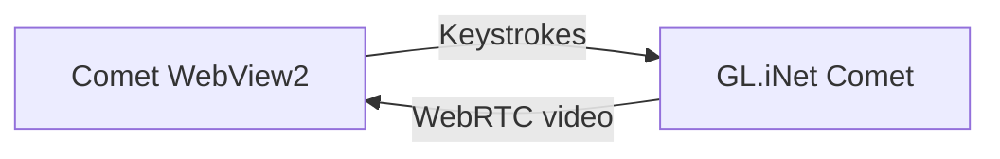

<h1 align="center">Comet WebView2</h1>

Keyboard capture for GL.iNet Comet KVM sessions on Windows

A browser can intercept your shortcuts. Comet WebView2 captures them in Windows and sends them to your KVM session.

## Connect

**Requirements:** Windows 10 or 11 (x64), the [Microsoft Edge WebView2 Runtime](https://developer.microsoft.com/microsoft-edge/webview2) and a reachable GL.iNet Comet.

1. Extract the entire ZIP and open `Comet-WebView2.exe`.
2. Enter the Comet’s HTTPS address and password, then click **Connect**. On first use, verify the certificate fingerprint before selecting **Trust and connect**.
3. Click the video to capture the keyboard. Click another window to release it. Moving the pointer alone keeps capture active.

**Remember password** saves the password encrypted for your Windows account. Profiles and settings are stored in `%LOCALAPPDATA%\Comet-WebView2`.

## Keyboard shortcuts

When the toolbar shows **Keyboard captured**, the app forwards every press and release it receives for the [mapped keys](src/keyboard/keymap.rs). You can use any combination of those keys without registering a shortcut or editing a configuration file.

A few examples in the KVM session:

- **Ctrl+W** closes the active tab in a browser.
- **Alt+Tab** switches between Windows applications.
- **Win+V** opens Windows clipboard history if enabled.

Use the toolbar button to turn capture off. **Typing only** means system shortcuts may still act locally.

The Comet firmware handles the microphone, camera and other peripherals.

## Build and test

| Task | Tools | Command |
| --- | --- | --- |
| Build the executable | Stable Rust x64 (MSVC) via rustup, Visual Studio C++ Build Tools and Windows SDK | `cargo build --release --locked` |
| Create the portable ZIP | Build tools above + Windows PowerShell 5.1 or later | `powershell -NoProfile -ExecutionPolicy RemoteSigned -File .\scripts\build.ps1` |
| Run Rust tests | Same tools as the build | `cargo test --locked` |
| Run interface and keyboard bridge tests | Node.js 24 | `node --test "tests/*.test.mjs"` |

The executable is written to `target\release\comet-webview2.exe` and the ZIP to `dist\Comet-WebView2.zip`.
