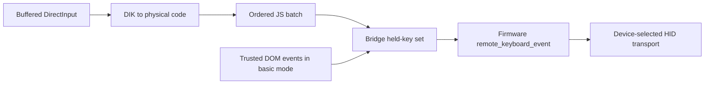

# Maintaining Comet WebView2

This is a Windows desktop client that hosts the Comet's existing web interface
and adds native keyboard capture. It does not implement video streaming or the
device's HID transport. Start with `main.rs`, then `app/mod.rs`; read the relevant
module comments before changing an integration. The root [README](../README.md)
covers usage and build prerequisites.

This guide explains cross-module decisions and current limitations. Function
comments describe local invariants. When changing a wire format, storage format,
or firmware assumption, update its producer, consumer, tests and this guide
together.

## Source map

| Location | Responsibility |
| --- | --- |
| `main.rs` | Process entry and a native startup-error dialog, including when WebView2 cannot start. |
| `app/mod.rs` | Tao event loop, owned application state, capture arbitration, UI snapshots and diagnostics. |
| `app/events.rs` | Owned messages from callbacks/workers into the event loop. |
| `app/commands.rs` | Local UI command schema, surface permissions, profile/settings actions. |
| `app/login.rs` | Background authentication, certificate approval and viewer replacement. |
| `app/layout.rs` | Toolbar animation and native child-view bounds. |
| `connection/mod.rs` | One pinned TLS login request using the firmware's fixed `admin` account. |
| `connection/tls.rs` | Certificate fingerprints, origin checks and WebView2 certificate-error exceptions. |
| `connection/response.rs` | Bounded HTTP response parsing for login only. |
| `storage/mod.rs` | JSON reads and transactional file replacement. |
| `storage/profiles.rs` | Validated profiles, canonical URLs, certificate pins and DPAPI passwords. |
| `storage/preferences.rs` | Theme, language, capture preference and toolbar pinning. |
| `keyboard/mod.rs` | Buffered exclusive DirectInput input, physical state and local Alt handling. |
| `keyboard/keymap.rs` | DirectInput offsets to physical `KeyboardEvent.code` names. |
| `keyboard/bridge.js` | Injected firmware adapter: remote key ledger, DOM fallback and telemetry. |
| `ui/mod.rs` | WebView construction, embedded asset serving, origin restrictions and DPI geometry. |
| `ui/locale.rs` | English fallback, optional translation overlays and native text lookup. |
| `ui/controls.js` | Shared text, theme and stable profile-list helpers. |
| `ui/manager.*`, `ui/toolbar.*`, `ui/theme.css` | Embedded local interface and its presentation. |
| `../tests/*.test.mjs` | Dependency-free Node VM/source checks for JS contracts. |
| `../build.rs`, `../scripts/build.ps1`, `../.github/workflows/windows.yml` | Windows resources, portable packaging and CI/release artifacts. |

There is no frontend package manager, bundler or generated JS layer. HTML, CSS,
JS and built-in English strings are embedded with Rust `include_*` macros, so
asset changes require rebuilding the executable. External translations are the
exception; see [the locale instructions](../locales/README.md).

## Ownership and application state

One top-level Tao window contains two persistent local child WebViews (toolbar
and connection manager) and at most one device viewer. The manager and viewer
share the body rectangle and switch visibility. The toolbar occupies its own
rectangle. They share a `WebContext`; builders request incognito operation and
disable browser accelerators, default context menus and new windows. Debug
builds enable developer tools.

Only the event-loop thread mutates `App` or operates its views. WebView callbacks
and login workers enqueue `AppEvent` through a proxy. Login performs blocking
DNS/TCP/TLS/HTTP work on a worker; keyboard reads and JS dispatch stay on the
window thread. Polling targets 8 ms while native capture is acquired, 16 ms during
toolbar animation, and 100 ms otherwise. These are wake-up targets, not real-time
delivery guarantees.

Three profile identities intentionally coexist:

- `selected` is the manager's editor selection.
- `pending.profile` is an owned snapshot for a login in progress.
- `remote` holds the displayed viewer's profile ID, original URL and session ID.

Editing, deleting or connecting another profile does not immediately destroy the
old viewer. A new view is built before replacing it; construction failure leaves
the old one available. `viewer_id()` returns a saved profile ID only if its URL
still matches that live viewer. Do not derive the displayed connection from the
editor selection.

Every new login increments `next_attempt`. Cancellation drops `pending` but does
not stop its worker or prevent a request already in progress. Results apply only
to the matching pending attempt. A successful attempt also supplies the viewer's
session ID; queued remote messages apply only to that displayed session. A new
pending attempt must not invalidate messages from an older, still-live viewer.

The manager stays logically visible during a 160 ms wait covering its 150 ms CSS
exit animation. Late manager commands are ignored during that interval except
`ui_ready`. Keep `MANAGER_EXIT_ANIMATION` long enough to cover the CSS exit.
Showing the manager releases capture; returning to the viewer focuses it without
acquiring capture automatically. Shutdown releases input and allows a 300 ms grace period
before exiting; there is no remote acknowledgement.

## Authentication and trust

```mermaid
sequenceDiagram
    participant UI as Local manager
    participant App as Event loop
    participant Worker as Login worker
    participant KVM as Comet
    UI->>App: Save/connect profile
    App->>Worker: Profile snapshot + password + attempt
    Worker->>KVM: TLS handshake
    KVM-->>Worker: Public certificate
    alt Missing or different saved fingerprint
        Worker-->>App: TrustRequired
        App-->>UI: Attempt + observed/previous fingerprints
        UI->>App: Approve exact attempt + fingerprint
        App->>App: Persist fingerprint
        App->>Worker: Retry with updated profile
        Worker->>KVM: Fresh TLS handshake; recheck fingerprint
    end
    Worker->>KVM: POST /api/auth/login after exact pin match
    KVM-->>Worker: Session token
    Worker-->>App: Authenticated token for attempt
    App->>App: Build and replace viewer for that session
```

Native login accepts the TLS handshake without CA/hostname validation solely to
observe the device's leaf certificate. It sends **no HTTP request or password**
until SHA-256 of that connection's DER certificate exactly matches the saved pin.
First use and a changed certificate both require explicit approval. Approval is
bound to the pending attempt and observed fingerprint, saved before retrying;
each retry checks its own fresh connection. Trust remains saved if authentication
later fails or the user cancels.

The browser path is distinct. A hidden `about:blank` viewer is created, its
certificate-error handler is installed, and only then is the device URL loaded.
That handler defaults to cancelling errors and allows an exception only for the
configured HTTPS origin and matching certificate fingerprint. **It handles
certificate errors; it is not a general verifier of every browser connection.**
Certificates WebView2 accepts normally do not undergo that handler's pin check.
Do not describe the browser path as unconditional certificate pinning.

The login HTTP reader is deliberately small: one request, no redirects/retries or
general HTTP client behavior. It accepts declared content length, chunked data
with trailers, or close-delimited bodies. It rejects ambiguous framing and limits
headers/body/chunk framing/trailers together to 1 MiB. Socket timeouts do not make
worker cancellation immediate; DNS also runs inside the worker.

The token is JSON-escaped into a document initialization script and written to
`localStorage['gl-kvm-token-keys']` as `{glkvm: token}` only in the configured
top-level origin. This is a firmware contract. Device code at that origin is
trusted with its own token and keyboard stream; the injected bridge is not an
isolation boundary against that firmware. Rust `Zeroizing` values reduce secret
lifetimes but cannot erase all copies in JSON values, JS strings, initialization
scripts, browser storage or networking internals. Do not add payload/debug logging
to events or commands that can contain passwords or tokens.

## Rust/JavaScript contracts

All messages are JSON strings. Serde enums use a snake_case `kind` discriminator.
Local commands and device observations are separate deserialization paths.

| Path | Contract |
| --- | --- |
| Local UI → Rust | `cometUI.ipc` posts commands defined by `app/commands.rs::Command`; Rust assigns `Surface` from the originating view. |
| Rust → manager | `cometManager.update(state)`; `prepare()`, `enter()`, `leave()` control transitions. |
| Rust → toolbar | `cometToolbar.profiles(state)`, `update(status)`, `layout(layout)`; these have separate schemas. |
| Rust → local UIs | `cometUI.setTheme(theme)` updates CSS state after native settings are saved. |
| Device bridge → Rust | `capture {enabled}`, `ready`, `stats`; defined by `RemoteMessage` in `app/mod.rs`. |
| Rust → device bridge | `__cometNative.setCaptured(enabled, useDom?)` and `batch([[code, down], ...])`; the bridge also exposes `key()` and `release()`. |
| Bridge → firmware | Same-origin `postMessage` of a JSON string: `{action: 'remote_keyboard_event', payload: {key: code, state: down}}`. |

Local pages load from the embedded `comet://localhost` protocol, exposed by Wry
as `https://comet.localhost`. Each local view allows navigation and IPC only at
its own exact page URL; IPC bodies are capped at 65,536 bytes. `allowed_from`
further restricts commands by manager/toolbar surface. Device navigation/IPC must
match the configured HTTPS origin, including port, with no embedded credentials;
remote IPC must be smaller than 4,096 bytes. Remote messages do not gain access to
local profile or trust commands. JS data passed through evaluated scripts must
be serialized with `serde_json`, not interpolated as raw user text.

`publish()` sends the public profile list, editor selection, viewer identity,
`form_version`, busy/notice/trust state and manager visibility to both local UIs.
Public profiles expose `has_password`, never ciphertext or plaintext. Routine
snapshots must preserve edits: the manager refills fields only when Rust changes
`form_version`. Shared profile-list helpers retain DOM nodes by ID to preserve
focus and open selectors. The toolbar may retain a user's pending selection
across unrelated status updates rather than always selecting the live viewer.
Render names, addresses, notices and translations as text, never HTML.

## Keyboard capture and release



Keep three meanings separate:

| State | Meaning |
| --- | --- |
| `settings.keyboard_capture` | Saved permission to acquire capture, changed by the toolbar switch. |
| `capture_requested` | A current capture session, including the DOM fallback. |
| `capture.enabled()` | An exclusive DirectInput keyboard is currently owned. |

A console click or toolbar action requests acquisition. Rust checks the saved
preference, active viewer, connection telemetry, manager visibility, foreground
window and shutdown state. Hovering does not arm capture. A request from the
device cannot override the saved preference. Connected control sockets permit
capture with no HDMI signal; video width is not a capture prerequisite.

DirectInput uses a 256-event buffer, draining up to 64 ordered transitions per
poll. `Keyboard.held` filters duplicate physical transitions. It forwards physical
positions, including left/right modifiers, rather than characters; the remote
keyboard layout interprets them. Unsupported offsets are ignored. A buffer
overflow is a capture-ending error because a missing key-up could leave a remote
modifier stuck. The raw COM vtable call preserves that success-status detail
which the projected method would discard.

The bridge maintains a second ledger containing keys actually sent remotely.
`App::release()` must unacquire the native device **and** call
`setCaptured(false)` so the bridge sends releases for its ledger. Native release
alone is insufficient. Release occurs on foreground loss, manager entry,
navigation/reset, disconnection, input errors, explicit suspension and shutdown.
Child WebView focus changes alone do not mean the top-level app lost foreground.
Synthetic releases are best effort if the document or transport has disappeared.

Failed exclusive acquisition enables basic typing using trusted DOM events. It
does not promise capture of system shortcuts. In exclusive mode the bridge blocks
the firmware's duplicate DOM key path; it also blocks that path over the selected
console while capture is disabled. This keeps the manual off switch effective.
Browser Keyboard Lock is neutralized when its API can be replaced because it
competes with native capture. There is no reserved release chord; mapped shortcuts
are ordinary remote input. Windows' physical Ctrl+Alt+Del remains local.

Local Alt handling is intentional: DirectInput retains the physical Alt state
while `SendInput` sends a local logical Alt-up tagged with scan offset `0x7f`.
That position must remain unmapped so it cannot release remote Alt. Preserve the
focused-top-level-window check and tests when changing this workaround.

Firmware-sensitive integration points are `/api/auth/login`, `admin`, the token
storage key/shape, `remote_keyboard_event`, `/api/ws`, and the console selectors
`video`, `#video-wrapper`, `#stream-box`. A firmware update can break those
assumptions without changing Rust types. Verify them against an actual device
when compatibility changes.

## Persistence, locale and layout decisions

Data lives under `%LOCALAPPDATA%\Comet-WebView2`: `settings.json`,
`connections.json`, the `WebView2` context directory, and optionally diagnostics.
Missing settings create defaults; missing profiles start with no trusted devices.
Malformed settings/profiles fail rather than silently overwrite saved data.
Settings use Serde defaults for omitted fields. Profile config is version `1`;
unsupported versions fail and need an explicit migration if the format changes.

Profile and settings updates clone the current state, edit the clone, serialize
to a unique sibling temporary file, flush it, then replace the destination
through `MoveFileExW`.
Only a successful disk replacement publishes the clone in memory. Temporary
cleanup touches only the file this write created. This does not provide
cross-process locking: simultaneous app instances can overwrite each other's
latest changes.

Profiles accept canonical HTTPS root URLs and optional nondefault ports, reject
URL credentials, queries and non-root paths, and discard fragments. URL changes clear the
previous saved password and certificate trust; that same save may store a newly
entered password if remembering is enabled. DPAPI encryption uses the current
Windows user and additional entropy `Comet-WebView2/v1|{profile_id}|{canonical_url}`. That exact
binding is a storage contract; changing it without migration prevents decryption.
It prevents casual ciphertext reuse across profiles but is not a secret from
software running as the same user. An empty password with `remember: true`
preserves the saved value for an unchanged URL; a nonempty password replaces the
saved value only with `remember: true`. `remember: false` removes it but still
permits the submitted password for the current login. Forgetting a stored
password does not revoke an already-open device session.

Locale initialization happens once after settings load. Bundled English is
always available, including startup errors before initialization. Optional
`locales/en.json` beside the executable overlays English; a selected valid
language file overlays that result. Missing/invalid files fall back. New labels
need entries in `../locales/en.json` and the existing `{placeholder}` names must
remain compatible between native and JS formatting. The device's own language
and application theme controls remain firmware-owned. The host also propagates
its theme preference to the remote WebView, which may influence browser styling.

Toolbar heights are logical pixels (`48` expanded, `3` collapsed). Native bounds
convert through current DPI, round, and clamp to the client area. The toolbar
viewport keeps its expanded height and slides upward; shrinking its viewport
would reflow controls into the reveal edge. Body views start below the visible
portion and never overlap it. Native animation respects Windows client-area
animation settings; local CSS/JS also honor reduced motion.

## Validation and troubleshooting

Use the commands in the root README. The complete Rust build/test path requires
Windows and the Windows SDK; a normal Linux-host `cargo test` is not supported.
The dependency-free Node suite runs on other hosts with Node 24:

```sh
cargo fmt --all -- --check
node --test "tests/*.test.mjs"
```

On Windows, also run `cargo test --locked` and build with
`cargo build --release --locked`. Rust unit tests exercise URL validation, DPAPI
binding, persistence rollback, HTTP framing, origin checks, locale fallbacks,
keyboard transitions and layout/animation math. Node tests execute JS in small
VM/DOM harnesses and check source contracts; they do not start WebView2, exercise
the Windows desktop, or establish a real HID/video connection.

The ignored `real_kvm_authentication_and_pin_before_credentials` Rust test needs
`COMET_TEST_URL`, `COMET_TEST_SHA256` and `COMET_TEST_PASSWORD`. Supply the expected
fingerprint from an independently verified device. Run it explicitly with
`cargo test --locked real_kvm_authentication_and_pin_before_credentials -- --ignored`.
It authenticates to a real device and creates/deletes its own temporary profile
store; it is not part of routine CI.

For changes to native capture or firmware integration, manually verify a console
click, mapped chords, focus loss with held modifiers, manager entry/return,
capture off/on, disconnection, and a connected device without HDMI. For layout
changes, check DPI scaling, toolbar pin/reveal, fullscreen and reduced motion.
These checks cover behaviors the harnesses cannot observe.

Opt-in keyboard diagnostics write a best-effort JSON snapshot once per second.
Use `--keyboard-diagnostics` for the default `keyboard-health.json` under the data
root, or set `COMET_KEYBOARD_DIAGNOSTICS` to choose a path. The environment value
takes precedence. It contains capture state/errors and counters, not key values,
passwords or tokens. Native-forwarded counts measure dispatch attempts; HID
counts are a byte-pattern heuristic over WebSocket/DataChannel sends, not remote
delivery acknowledgements. `connected` comes from an open `/api/ws` control socket
or observed video progress and can lag by the one-second reporting interval.

The PowerShell packager builds locked release inputs and explicitly adds allowed
files to the ZIP rather than archiving the whole output directory. Preserve that
allowlist. MSVC uses the static WebView2 loader; the LLVM-MinGW variant also needs
its loader/unwind DLLs and associated license. Runtime language files remain an
optional user addition. CI runs formatting, Rust and Node tests before packaging.
Version tags must match `Cargo.toml`; a new tagged release starts as a draft,
while an existing release has its ZIP replaced. Packaging changes may also need
updates to `../THIRD-PARTY-NOTICES.md`.
